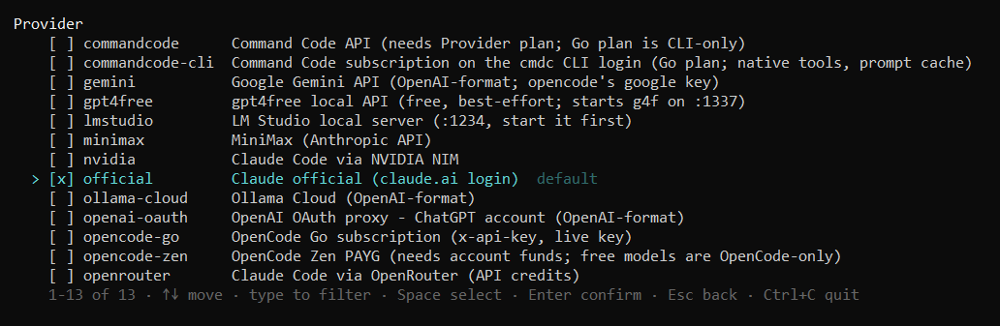
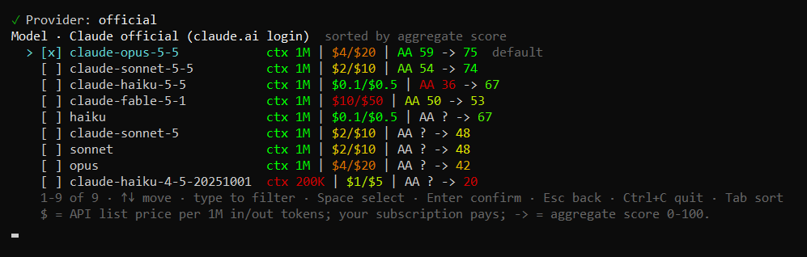
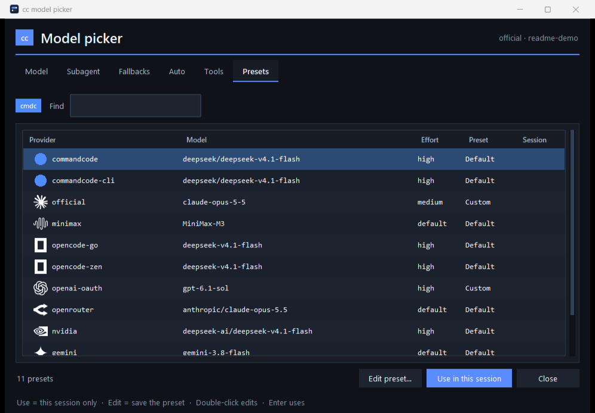
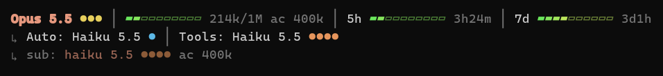

# cc — Claude Code on any provider

`cc` launches Claude Code on Anthropic or on a dozen other providers (Command Code, OpenAI OAuth,
OpenRouter, NVIDIA, Gemini, OpenCode, MiniMax, Ollama Cloud, LM Studio, gpt4free). It includes a local
adapter that turns Claude's Messages API into OpenAI Chat Completions. It also adds a `/model` picker
window, a status line with quotas, subagents that run on other providers, and fallback routes.

Windows only. Requirements: Python 3.10+, PowerShell and `claude` on PATH. The scripts use only the
standard library. The `openai-oauth` route also needs Node.js and an
[openai-oauth](https://github.com/EvanZhouDev/openai-oauth) install.




## Install

```powershell
python -B install-resume.py     # run from this checkout
```

The installer copies the runtime to `~/.config/cc` and backs up the files it replaces. It adds a `cc`
function to both PowerShell profiles, and installs the status line and delegation hooks without
touching your other settings. Open a new terminal afterwards. With a redirected Documents folder,
add the function by hand:

```powershell
function cc { & "$env:USERPROFILE\.config\cc\cc-switch.ps1" @args }
```

Credentials, saved picks and backups stay in `~/.config/cc` and are never committed. When a provider
has no key, `cc` asks once and saves it to `keys.json`, readable only by you.

## Usage

```powershell
cc                                   # menus: provider, model, effort, auto-compact, subagent, fallback
cc official                          # normal Claude login
cc openai-oauth gpt-6.1-sol          # ChatGPT account through the adapter
cc commandcode-cli deepseek/deepseek-v4.1-flash
cc openrouter anthropic/claude-opus-5.5 --autocompact 70
cc -NoRun nvidia <model-id>          # configure this terminal only, then run `claude`
cc --resume [id] | cc --continue     # reuses the last provider unless you name one
cc status
```

| Route | How it connects |
|---|---|
| `official` | Through the adapter, untouched until `/model` or a fallback reroutes it (`CC_OFFICIAL_DIRECT=1` connects directly) |
| `commandcode`, `minimax`, `opencode-*`, `openrouter` | Anthropic-format endpoint, direct; models the endpoint doesn't serve go through the adapter |
| `openai-oauth`, `nvidia`, `gemini`, `ollama-cloud`, `lmstudio`, `gpt4free` | Local adapter on `127.0.0.1:10532` |
| `commandcode-cli` | Adapter runs `cmdc` once per request (Command Code subscription, Go plan included) |

The adapter passes through streaming text, thinking, tools, images, usage and effort. It stores no
keys and logs no prompts. Each model gets its declared context window
(`CLAUDE_CODE_MAX_CONTEXT_TOKENS`), and `/effort` keeps working on models Claude Code doesn't know.
Non-Claude models are experimental in Claude Code: tool use is not guaranteed. Server-side Anthropic
tools and prompt cache controls do not carry over.

## `/model` picker

`/model` with no arguments opens a picker window (Tkinter, no dependencies). It has six tabs: Model,
Subagent, Fallbacks, Auto, Tools and Presets. Each tab has search and sorting by intelligence, score,
context, price or family, and shows the effort and auto-compact controls. On adapter routes the
Model tab switches provider and model live for this session only. Direct routes copy a
`cc … --resume` command that continues the conversation on the new provider. `/model <id>` still works
the usual way. Without a window (for example, no Tk) the picker falls back to an in-terminal grid.




Presets store one Enter-away bundle per provider (main model, subagent, fallback, Auto and Tools
helpers): `cc presets`, `cc presets set <provider> <model> [effort]`. `cc gui [tab]` opens the window
directly.

## Status line



The first line shows the model, its effort dots (one per step of that model's own ladder), context
use with the auto-compact point, and quota windows with time to reset. The second line shows the
Auto and Tools helper models. The `sub:` line shows each configured subagent's route. Quotas come
from the provider's usage endpoint or from the adapter's last rate-limit headers. A failed fetch
names its cause (`key expired`, `auth failed`) instead of hiding the bar.

## Subagents on other providers

Profiles in `~/.config/cc/agents.json` each run as their own headless `claude -p`, with their own
provider, model, effort and auto-compact:

```json
{ "cheap": {"provider": "openai-oauth", "model": "gpt-6-luna", "effort": "low", "autocompact": 60},
  "deep":  {"provider": "official", "model": "claude-opus-5-5", "effort": "max"} }
```

```powershell
cc agents                                    # edit profiles in a menu
cc agents set cheap --provider nvidia --model deepseek-ai/deepseek-v4-pro --effort low
cc agent cheap "task text"                   # run one task directly
```

Each profile becomes a `cc-<name>` subagent type. The installed hooks steer delegation to those
types. A worker resumes an isolated copy of the parent conversation, plus project instructions and
memory, and never rewrites the original transcript. In adapter sessions the worker runs in-process,
so its tab shows the full chat.

## Fallbacks and limits

- **Fallback route:** an adapter session can name a second route, used once when the first answers
  429, 402 or 5xx. Set it with `/fallback <provider> <model>`, `/fallback off`, or in the launch menu.
- **Key rotation:** put spare keys, comma-separated, in `<KEY>_API_KEYS`. A key that hit a limit
  rests until its retry-after.
- **Usage limits:** when a provider reports a real reset time, the adapter returns Claude Code's own
  usage-limit headers, so `/rate-limit-options` and auto-continue work as on Anthropic.
- **OpenCode keys:** an expired Go/Zen key is renewed from a signed-in Chrome profile
  (`python opencode_key.py`).

## Tests

```powershell
python -B -m pytest -q     # offline: fake credentials, fake claude/codex, stubbed GUI
python -B critic_mock_check.py   # optional: real Claude Code against local mock providers
```

No paid generation runs in these checks. They do not cover live OAuth generation, account model
access or model quality.

References: [LLM gateway](https://code.claude.com/docs/en/llm-gateway) ·
[gateway protocol](https://code.claude.com/docs/en/llm-gateway-protocol) ·
[Command Code provider](https://commandcode.ai/docs/provider) ·
[OpenRouter + Claude Code](https://openrouter.ai/docs/cookbook/coding-agents/claude-code-integration)
